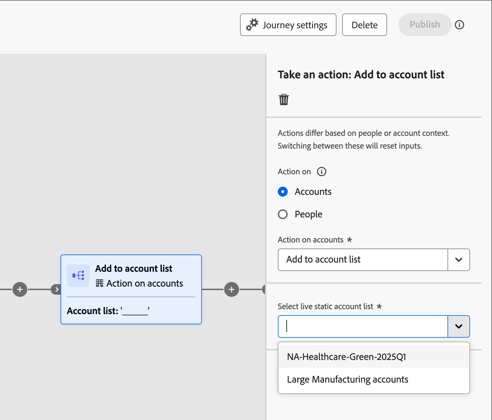

# 여정에서 계정 목록 사용

여러 가지 방법으로 라이브(게시된) 계정 목록을 계정 여정에 통합할 수 있습니다.

## 계정 대상자 노드

모든 계정 여정은 [_계정 대상자_ 노드](../journeys/account-audience-nodes.md)(으)로 시작합니다. 계정 목록을 사용하도록 이 노드를 설정하면 구성원 계정이 활성화(게시)될 때 해당 여정을 통해 이동합니다.

1. 시작 _계정 대상자_ 노드에 대해 **[!UICONTROL 계정 목록]** 옵션을 선택하십시오.

   {width="500"}

1. **[!UICONTROL 계정 목록 추가]**&#x200B;를 클릭합니다.

1. 계정 목록에 대한 확인란을 선택하고 **[!UICONTROL 저장]**&#x200B;을 클릭합니다.

   {width="600" zoomable="yes"}

## 작업 노드 - 계정에 추가

**_정적 계정 목록만_**

계정 여정 내에서 [a _작업 수행_ 노드](../journeys/action-nodes.md)을 사용하여 정적 계정 목록에 계정을 추가합니다.

예를 들어 이메일을 보내고 일부 계정이 응답으로 다양한 작업을 수행하는 여정 경로가 있습니다. 이 활동을 여정의 검증 포인트로 간주합니다. 자격 조건을 사용하면 자격 있는 계정에 대해 다른 플로우를 가진 다른 여정의 대상자로 사용되는 계정 목록에 해당 자격 조건을 추가할 수 있습니다.

>[!NOTE]
>
>노드가 실행될 때 계정이 이미 목록에 있는 경우 작업이 무시됩니다.

1. _&#x200B;**[!UICONTROL 계정]**&#x200B;에 대한_&#x200B;작업 옵션을 선택하십시오.

1. _[!UICONTROL 계정에 대한 작업]_&#x200B;의 경우 **[!UICONTROL 계정 목록에 추가]**&#x200B;를 선택하세요.

   {width="500"}

1. **[!UICONTROL 실시간 정적 계정 목록 선택]**&#x200B;의 경우 계정을 추가할 계정 목록을 선택하십시오.

   {width="500"}

## 작업 노드 - 계정에서 제거

**_정적 계정 목록만_**

계정 여정 내에서 [a _작업 수행_ 노드](../journeys/action-nodes.md)을 사용하여 정적 계정 목록에서 계정을 제거하십시오.

예를 들어 이메일을 보내고 일부 계정이 응답으로 다양한 작업을 수행하는 여정 경로가 있습니다. 이 활동을 여정의 검증 포인트로 간주합니다. 이 조건을 사용하면 계정 목록에서 제거할 수 있습니다. 이 목록은 자격 증명 커뮤니케이션이 중복되지 않도록 추가 이메일을 보내는 다른 여정의 대상자로 사용됩니다.

>[!NOTE]
>
>계정이 제거가 예약된 목록에 없으면 작업이 무시됩니다.

1. _&#x200B;**[!UICONTROL 계정]**&#x200B;에 대한_&#x200B;작업 옵션을 선택하십시오.

1. _[!UICONTROL 계정에 대한 작업]_&#x200B;의 경우 **[!UICONTROL 계정 목록에서 제거]**&#x200B;를 선택하세요.

   {width="500"}

1. **[!UICONTROL 실시간 정적 계정 목록 선택]**&#x200B;의 경우 계정을 제거할 계정 목록을 선택하십시오.

   {width="500"}

## 분할 경로 노드 - 계정 목록의 계정 멤버 {#split-paths-account-member-of-account-list}

**_계정 여정 전용_**

계정별로 분할되는 [_경로 분할_ 노드](../journeys/split-merge-paths-nodes.md#add-a-split-path-by-account-node)에서 _[!UICONTROL 계정 구성원 목록]_ 필터를 사용합니다. 선택한 계정 목록 중 하나 이상에 속해 있거나 속해 있지 않습니다. 목록에 계정을 포함하려면 구성원 자격을 `true`(으)로 설정하거나 제외하려면 `false`(으)로 설정하십시오.

차단 목록에 추가하다에서 계정을 제외하려면 _[!UICONTROL 계정 목록의 계정 구성원]_ 필터를 추가하고 구성원 자격을 `false`(으)로 설정한 다음 목록을 선택하십시오.

1. 여정 맵으로 이동합니다.

1. 경로에서 더하기(**+**) 아이콘을 클릭하고 **[!UICONTROL 경로 분할]**&#x200B;을 선택합니다.

1. 오른쪽의 노드 속성에서 분할을 위해 **[!UICONTROL 계정]**&#x200B;을(를) 선택합니다.

1. _[!UICONTROL 경로 1]_&#x200B;에 대한 조건을 정의하려면 **[!UICONTROL 조건 적용]**&#x200B;을 클릭하십시오.

1. 계정 목록 필터를 정의합니다.

   * 조건 편집기에서 _[!UICONTROL 특수 필터]_ 폴더를 확장하고 **[!UICONTROL 계정 목록의 계정 구성원]** 필터를 조건 작업 공간으로 끌어서 놓습니다.

   * 목록에 계정을 포함하려면 구성원 자격을 `true`(으)로 설정하거나 제외하려면 `false`(으)로 설정하십시오.

   * 계정 목록을 하나 이상 선택합니다.

   {width="700" zoomable="yes"}

   계정 목록 멤버십 필터를 다른 계정 필터와 결합하고 모든 조건 또는 모든 조건을 일치시키도록 선택할 수 있습니다. 맨 위에 있는 **[!UICONTROL 필터 논리]**&#x200B;를 적용하여 조건을 구체화합니다.

1. **[!UICONTROL 완료]**&#x200B;를 클릭합니다.

[계정 노드별 분할 경로 추가](../journeys/split-merge-paths-nodes.md#add-a-split-path-by-account-node)에 설명된 대로 분할 경로 노드를 계속 구성합니다.

## 분할 경로 노드 - 계정 목록의 개인 멤버 {#split-paths-member-of-account-list}

**_개인 여정 전용_**

개인 여정의 [_경로 분할_ 노드](../journeys/split-merge-paths-nodes.md)에서 계정 목록 구성원 필터를 사용하여 해당 계정이 계정 목록의 구성원인지 여부에 따라 사용자를 라우팅합니다. 두 가지 필터를 사용할 수 있습니다.

| 필터 | 설명 |
| ------ | ----------- |
| [!UICONTROL 계정의 사용자 동적 목록] | 사용자의 계정이 하나 이상의 동적 계정 목록의 구성원이거나 구성원이 아닙니다. |
| [!UICONTROL 계정 정적 목록의 사용자 구성원] | 사용자의 계정이 하나 이상의 정적 계정 목록의 구성원이거나 구성원이 아닙니다. |

차단 목록에 추가된 계정의 사용자를 육성 경로에서 제외하려면 _[!UICONTROL 계정의 사용자 구성원]_ 필터를 추가하고 연산자를 `is not`(으)로 설정한 다음 목록을 선택하십시오.

1. 여정 맵으로 이동합니다.

1. 경로에서 더하기(**+**) 아이콘을 클릭하고 **[!UICONTROL 경로 분할]**&#x200B;을 선택합니다.

1. _[!UICONTROL 경로 1]_&#x200B;에 대한 조건을 정의하려면 **[!UICONTROL 조건 적용]**&#x200B;을 클릭하십시오.

1. 계정 목록 필터 정의

   * 조건 편집기에서 _[!UICONTROL 특수 필터]_ 폴더를 확장하고 **[!UICONTROL 계정의 사용자 동적 목록]** 또는 **[!UICONTROL 계정의 사용자 정적 목록]** 필터를 조건 작업 공간으로 끌어서 놓습니다.

   * 목록에 계정이 있는 사용자를 포함하려면 연산자를 `is`(으)로 설정하거나 제외하도록 `is not`(으)로 설정하십시오.

   * 계정 목록을 하나 이상 선택합니다.

     {width="700" zoomable="yes"}

   계정 목록 멤버십 필터를 다른 사람 필터와 결합하고 모든 조건 또는 모든 조건을 일치시키도록 선택할 수 있습니다. 맨 위에 있는 **[!UICONTROL 필터 논리]**&#x200B;를 적용하여 조건을 구체화합니다.

1. **[!UICONTROL 완료]**&#x200B;를 클릭합니다.

[사람 노드별 분할 경로 추가](../journeys/split-merge-paths-nodes.md#add-a-split-path-by-people-node)에 설명된 대로 분할 경로 노드를 계속 구성합니다.
