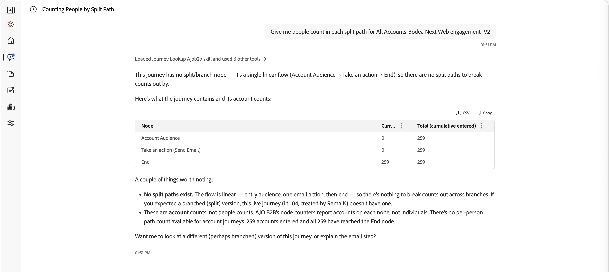

# B2B 여정 기술

[!DNL Adobe CX Enterprise Coworker] 채팅을 사용하여 [!DNL Adobe Journey Optimizer B2B Edition]에서 여정을 찾고, 만들고, 구성하세요. 개요에서 검증된 초안을 만들고 저장된 초안 그래프를 변경하고 설정을 다시 입력하고 구성되지 않은 노드를 구성합니다. 여정 변경 사항은 활성 여정이 아닌 저장된 초안에 적용됩니다.

조회, 만들기, 규칙 스킬 식별자 및 지원되는 작업에 대해서는 [Coworker 여정 스킬 참조](./coworker-overview.md#skills)를 참조하십시오. 이 문서에서는 간단한 준비 지침 및 여정 관찰 가능성 예를 제공합니다.

* [여정 만들기 지침](#journey-creation-skills): 만들기 전에 간단한 설명을 준비하고 초안을 검토하십시오.
* [여정 가시성 지침](#journey-observability-skills): 계정과 사용자가 활성 여정을 이동하는 방법에 대해 질문합니다.

앱을 열고 대화를 시작하는 방법에 대한 지침은 [Coworker 인터페이스 안내서](https://experienceleague.adobe.com/ko/docs/coworker/content/chat/ui-guide){target="_blank"}를 사용하십시오.

## 여정 제작 기술 {#journey-creation-skills}

여정 생성 스킬은 개요를 검증된 계정 또는 개인 여정 그래프로 변환합니다. 명명된 대상을 [!DNL Adobe Experience Platform] 대상 ID로 확인하고 초안을 만들기 전에 그래프를 미리 봅니다.

[!DNL Coworker]에서 초안을 만들기 전에 미리 보기를 명시적으로 승인해야 합니다. 작성 스킬은 대상을 검색하거나, 노드 규칙을 구성하거나, 메시지 사본을 작성하거나, 여정을 게시하거나, 삭제하지 않습니다.

### 개요 준비 {#basic-usage}

원하는 초안 여정을 자연어로 설명합니다. 다음 세부 정보를 포함합니다.

* 여정 유형: 계정 또는 개인.
* 기존 대상자: 사용할 대상자의 이름 또는 ID.
* 여정 흐름: 포함할 작업, 대기 및 분기.
* 재입력 설정: 계정 또는 사용자가 재입력할 수 있는지 여부와 시기

[!DNL Coworker]에서 목표를 해석할 수 있도록 캠페인 개요의 관련 세부 정보를 포함하십시오. 미리 보기가 의도한 흐름과 일치하지 않는 경우 요청을 세분화합니다.

{width="800" zoomable="yes"}

### 초안 검토 및 만들기 {#end-to-end-b2b-journey-creation}

검증된 미리보기에서 여정 유형, 해결된 대상, 노드 및 경로를 검토합니다. 그래프가 개요와 일치하는 경우에만 생성을 승인합니다.

승인 후 [!DNL Coworker]이(가) 초안을 만들고 링크를 반환합니다. 후속 요청을 사용하여 규칙 스킬을 통해 구성되지 않은 노드를 구성하십시오. 응용 프로그램에 메시지 복사본을 추가한 다음 [여정 검토 및 게시 단계](../journeys/create-publish-journey.md)를 완료하십시오.

전체 예제는 [계정 여정 작성](./coworker-overview.md#build-account-journey)을 참조하세요.

### 다단계 여정

여러 단계가 있는 여정의 경우 각 단계의 작업, 대기 및 분기를 요약에 설명하십시오. 초안 생성 후 구성한 규칙 및 메시지 복사본과 그래프 구조를 구별합니다.

저장된 초안을 수정하려면 작성 기술을 통해 그래프를 요청하거나 변경 사항을 다시 입력합니다. 분할 조건, 작업, 이벤트 및 구성되지 않은 노드의 동적 목록 대상자에 대해 규칙 기술을 사용합니다.

## 여정 가시성 기술 {#journey-observability-skills}

여정 가시성 기술을 사용하면 여정 맵, 로그 또는 대시보드를 자세히 살펴보지 않고도 계정과 사용자가 B2B 여정을 통해 어떻게 이동하는지 자연어 질문을 할 수 있습니다. 여정 진행과 데이터 동기화 가시성, 이렇게 두 가지 주요 영역을 다룹니다.

[!DNL CX Coworker]{width="800" zoomable="yes"}의 여정 관찰 가능성 프롬프트 및 응답

### 계정 수준 여정 insight

다음과 같은 질문을 하여 특정 계정이 여정을 어떻게 통과했는지 추적합니다.

* &quot;Bodea Cloud 계정에 대한 기본 정보를 제공합니다.&quot;
* &quot;Northstar Services 계정이 어떻게 여정 ABM 육성 전략을 거쳤는지 말씀해 주십시오.&quot;
* &quot;Contoso LLC 계정이 언제 이 여정을 시작했습니까?&quot;

### 분할 경로 추론 및 계산

분기를 사용하는 이유와 각 경로를 따르는 사람 또는 계정 수를 파악합니다.

* &quot;계정 QiDemoAccount24가 분할 노드 c764a9의 작은 미국 캘리포니아 기술 경로로 간 이유는 무엇입니까?&quot;
* &quot;분할된 노드-459c7c의 각 경로에 대한 인원 수를 제공합니다.&quot;
* &quot;계정8에 대해 산호세 경로에 있는 사람을 보여줍니다.&quot;

여정 가시성 스킬은 분할 논리, 계정 속성 및 활동을 분석하여 라우팅 의사 결정을 설명하고 경로당 카운트 또는 사용자 목록을 반환합니다.

### 사용자 수준 여정 결과

계정 내 또는 전체 여정에서 개별 결과를 분석합니다. 특히 그룹 분석 구매 및 의사 결정자와 영향력 행사자 행동을 추적하는 데 유용합니다.

* &quot;Bodea Next Web Engagement 여정의 각 분할 경로에서 사람들이 셀 수 있도록 합니다.&quot;
* &quot;숨겨진 건너뛰기 경로에 있는 사람을 나열합니다.&quot;
* &quot;이 계정의 샌디에이고 위치 경로에 있는 사람들을 보여 주십시오.&quot;

### 여정 라이프사이클 및 타이밍

여정 또는 특정 계정에 대한 주요 타임스탬프 검색:

* &quot;이 여정은 언제 실행되었습니까?&quot;
* &quot;첫 번째 계정은 언제 이 여정을 입력했습니까?&quot;
* &quot;QiDemoAccount50 계정이 이 여정을 시작한 것은 언제입니까?&quot;

### 외부 대상 및 활성화 가시성

LinkedIn과 같은 외부 채널로 푸시하는 여정의 경우 활성화 상태를 확인할 수 있습니다.

* &quot;외부 대상에 bsmith@acme.com이 있습니까?&quot;
* &quot;ObservabilityExtAudience01을 통해 LinkedIn에 활성화된 모든 사용자를 나열합니다.&quot;

### 데이터 동기화 및 파이프라인 가시성

또한 여정 가시성 스킬은 데이터 동기화 상태 정보를 표면화하여 계정이나 잠재 고객이 여정에 포함되지 않은 이유를 해결할 수 있습니다.

* 외부 대상 내보내기 작업 지표 및 상태
* 배치 세분화 일정 및 완료 시간
* 구매 그룹 유지 관리 일정
* 작업 관리자 통계(완료/실패)