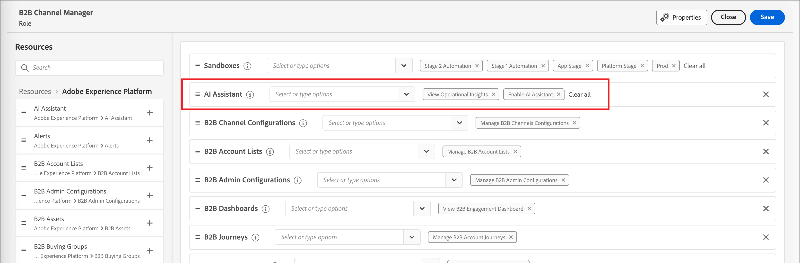

# AI 액세스 활성화

>[!IMPORTANT]
>
>[!DNL Coworker] 채팅에 대한 액세스 권한을 얻으려면 먼저 조직에서 추가 법률 약관에 동의해야 한다는 메시지가 권한 UI에 표시되면 Adobe 계정 팀에 연락하여 안내를 받으십시오.

[권한 UI](https://experienceleague.adobe.com/ko/docs/experience-platform/access-control/abac/permissions-ui/permissions){target="_blank"}을(를) 사용하여 조직의 [!DNL Coworker] 채팅에 대한 액세스 권한을 부여하거나 취소하세요. [!DNL Coworker] 채팅을 사용하려면 지정된 사용자가 _[!UICONTROL AI Assistant 사용]_ 및 _[!UICONTROL Operational Insights 보기]_ 권한으로 구성된 역할에 속해야 합니다.

관리자는 다음과 같은 작업을 수행할 수 있습니다.

* 지정된 역할에 **[!UICONTROL AI Assistant 사용]** 권한을 추가하고 사용자를 해당 역할에 추가합니다. 이 권한은 조직의 사용자를 위해 [!DNL Coworker] 채팅에 대한 액세스 권한을 제공합니다.

* 지정된 역할에 **[!UICONTROL View Operational Insights]** 권한을 추가하고 해당 역할에 사용자를 추가하십시오. 이 권한을 통해 사용자는 [!DNL Coworker] 채팅 operational insights 기능을 사용할 수 있습니다.

{width="800" zoomable="yes"}

권한 UI를 사용하여 [!DNL Adobe Journey Optimizer B2B Edition]에서 [!DNL Coworker] 채팅을 사용할 수 있는 권한을 부여합니다. [!DNL Adobe Experience Platform] 및 다른 [!DNL Adobe Experience Cloud] 응용 프로그램에서 [!DNL CX Coworker]에 액세스하는 방법에 대한 자세한 내용은 [CX Enterprise Coworker 설명서](https://experienceleague.adobe.com/ko/docs/coworker/content/chat/overview){target="_blank"}를 참조하세요.

사용자에게 필요한 권한이 있는 경우 응용 프로그램 상단 헤더의 _[!DNL Coworker]채팅_ 아이콘을 선택하여 [!DNL Coworker] 채팅에 액세스할 수 있습니다.

응용 프로그램 헤더의 ![[!DNL Coworker] 채팅 아이콘](./assets/coworker-icon-header.png){width="800" zoomable="yes"}
