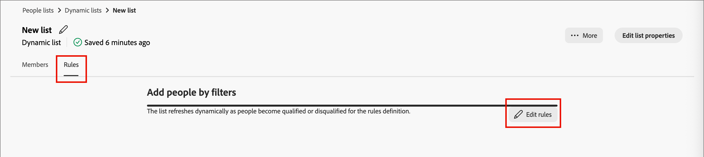

# 동적 사용자 목록

동적 [사용자 목록](./people-lists.md)은(는) 규칙(필터)으로 정의된 사용자 프로필 컬렉션입니다. 동적 목록 멤버십은 개인 속성 및 활동을 참조하는 간단한 필터를 사용하여 정의됩니다. 멤버십은 프로필이 필터 논리에 따라 자격을 부여하고 자격을 박탈할 때 자동으로 유지됩니다.

동적 목록에서 개별 사용자를 추가하거나 제거할 수 없습니다. 목록 멤버십을 변경하려면 해당 규칙을 업데이트합니다. 수동으로 또는 여정을 통해 멤버십을 관리해야 하는 경우 대신 [정적 목록](./people-lists-static.md)을 사용하세요.

## 멤버십 규칙 설정 {#set-membership-rules}

>[!NOTE]
>
>규칙이 없는 동적 목록에 구성원이 없습니다. 목록을 채우려면 필터를 하나 이상 추가합니다.

1. 동적 목록을 열고 **[!UICONTROL 규칙]** 탭을 선택합니다.

1. **[!UICONTROL 규칙 편집]**&#x200B;을 클릭합니다.

   {width="700" zoomable="yes"}

1. _[!UICONTROL 규칙 편집]_ 대화 상자에서 왼쪽 패널에서 필터를 끌어 프로필에 대한 규칙을 정의합니다.

   다음을 조합하여 목록에 맞게 프로필 자격 부여:

   * 활동 기록
   * [!DNL Experience Platform]개의 활성화된 사용자 필드
   * 사용자 정의 필드
   * 의도 데이터
   * 개인 속성
   * 여정 멤버십과 같은 특수 필터

   추가하는 각 필터에 대해 **[!UICONTROL 제약 조건 추가]**&#x200B;를 클릭하여 일치하는 조건을 구체화합니다. 맨 위에 있는 **[!UICONTROL 필터 논리]**&#x200B;를 적용하여 조건을 미세 조정하십시오. 모든 조건, 모든 조건을 일치시키거나 고급 논리를 정의하도록 선택할 수 있습니다.

   {width="700" zoomable="yes"}

1. 변경 내용을 저장하려면 **[!UICONTROL 완료]**&#x200B;를 클릭하세요.

   **[!UICONTROL 규칙]** 탭에는 목록에 대한 필터 및 필터 논리가 표시되며 **[!UICONTROL 구성원]** 탭이 새로 고침되어 업데이트된 구성원 자격을 반영합니다. 최신 대상자 자격을 찾으려면 **[!UICONTROL 자세히]** 메뉴에서 **[!UICONTROL 구성원 새로 고침]**&#x200B;을 사용하세요.

1. **[!UICONTROL 구성원]** 탭을 선택합니다.

   자격을 갖춘 멤버는 잠시 지연된 후 목록에 표시됩니다.

   {width="700" zoomable="yes"}

>[!NOTE]
>
>언제든지 목록 규칙을 변경하려면 이 단계를 반복하면 됩니다. 목록 멤버십은 저장된 필터를 기반으로 새로 고쳐집니다.

<!--

## Duplicate a dynamic list {#duplicate-dynamic-list}

Duplicating a dynamic list replicates its membership filtering so that you can reuse it in a different context.

1. In the _[!UICONTROL Dynamic lists]_ tab, click the _More menu_ ( **...** ) icon next to the list and choose **[!UICONTROL Duplicate]**.

1. Enter a unique **[!UICONTROL Name]** (required) and a **[!UICONTROL Description]** (optional).

   By default, the dialog appends `_copy` to the name of the originating list. Enter a different unique name as needed.

   {width="375"}

1. Click **[!UICONTROL Duplicate]**.
-->
