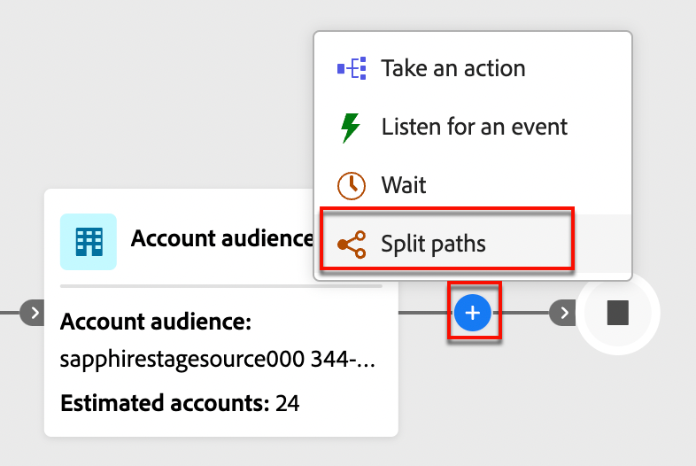

# 여정에서 사람 목록 사용

계정 여정 및 사용자 여정에 [사람 목록](./people-lists.md)을 통합할 수 있는 방법에는 여러 가지가 있습니다.

* **여정에서 정적 목록 유지** - _작업 수행_ 노드에서 _[!UICONTROL 사람 목록에 추가]_ 또는 _[!UICONTROL 사람 목록에서 제거]_ 작업을 사용하여 사람들이 여정을 이동할 때 정적 사람 목록의 구성원을 업데이트합니다.
* **목록 구성원 자격을 기준으로 사용자 경로 지정** - _분리된 경로_ 노드에서 _[!UICONTROL 사용자 정적 목록의 사용자 구성원]_ 또는 _[!UICONTROL 사용자 동적 목록의 사용자 구성원]_ 필터를 사용하여 목록의 구성원(또는 구성원이 아님)인 사용자에 대한 경로를 만듭니다.

예를 들어 팀 구성원 및 파트너의 제외 목록을 작성하고 이 목록을 사용하여 해당 사람을 지원 경로에서 제외할 수 있습니다. 또는 한 여정에서 자격 지점에 도달한 사람들을 정적 목록에 추가한 다음 해당 목록을 사용하여 다른 여정에서 사람들을 분기할 수 있습니다.

## 작업 노드 수행 - 사람 목록에 추가 {#add-to-people-list}

**_정적 사용자 목록만_**

계정 또는 사용자 여정 내에서 [작업 수행&#x200B;_노드](../journeys/action-nodes.md#people-actions)을 사용하여 정적 사용자 목록에 사용자를 추가하십시오._

예를 들어, 이메일을 보내고 일부 사람들이 웨비나를 등록하는 여정 경로를 생각해 보십시오. 이 응답을 여정의 검증 지점으로 간주합니다. 자격을 지정하면 다른 여정이 자격을 갖춘 사람을 다른 경로로 분할하는 데 사용하는 정적 사람 목록에 이러한 사람을 추가할 수 있습니다.

>[!NOTE]
>
>노드가 실행될 때 이미 목록에 있는 사람은 작업이 무시됩니다.

1. 여정 맵으로 이동합니다.

1. 경로에서 더하기(**+**) 아이콘을 클릭하고 **[!UICONTROL 작업 수행]**&#x200B;을 선택합니다.

1. (계정 여정 전용) _[!UICONTROL 다음에 대한]_ **[!UICONTROL 사람]** 옵션을 선택합니다.

1. _[!UICONTROL 인물 작업]_&#x200B;에 대해 **[!UICONTROL 인물 목록에 추가]**&#x200B;를 선택하세요.

1. **[!UICONTROL 정적 직원 목록 선택]**&#x200B;의 경우 직원을 추가할 직원 목록을 선택하십시오.

   {width="300"}

## 작업 노드 - 사람 목록에서 제거 {#remove-from-people-list}

**_정적 사용자 목록만_**

계정 또는 사용자 여정 내에서 [작업 수행&#x200B;_노드](../journeys/action-nodes.md#people-actions)을 사용하여 정적 사용자 목록에서 사용자를 제거하십시오._

예를 들어, 사용자가 전환한 후 정적 목록에서 해당 사용자를 제거할 수 있습니다. 이 목록은 사람들을 더 이상 육성 커뮤니케이션을 받지 않도록 육성 경로로 라우팅하는 데 사용됩니다.

>[!NOTE]
>
>제거 예정인 목록에 개인이 없는 경우 작업이 무시됩니다.

1. 여정 맵으로 이동합니다.

1. 경로에서 더하기(**+**) 아이콘을 클릭하고 **[!UICONTROL 작업 수행]**&#x200B;을 선택합니다.

1. (계정 여정 전용) _[!UICONTROL 다음에 대한]_ **[!UICONTROL 사람]** 옵션을 선택합니다.

1. _[!UICONTROL 인물]_&#x200B;에 대한 액션&#x200B;**[!UICONTROL 인물 목록에서 제거]**&#x200B;를 선택하세요.

1. **[!UICONTROL 정적 직원 목록 선택]**&#x200B;의 경우 직원을 제거할 직원 목록을 선택하십시오.

   {width="300"}

## 경로 분할 노드 - 사용자 목록 {#split-paths-by-list-membership}

**_계정 및 개인 여정_**

[_경로 분할_ 노드](../journeys/split-merge-paths-nodes.md)에서 사용자 목록 구성원 필터를 사용하여 사용자 목록의 구성원인지 여부에 따라 사용자를 라우팅합니다. 두 가지 필터를 사용할 수 있습니다.

| 필터 | 설명 |
| ------ | ----------- |
| [!UICONTROL 사람 동적 목록의 사용자 구성원] | 해당 사용자는 하나 이상의 동적 사용자 목록에 속하거나 속하지 않습니다. 멤버십은 목록의 현재 규칙을 반영합니다. |
| [!UICONTROL People 정적 목록의 사용자 구성원] | 해당 사용자는 하나 이상의 정적 사용자 목록의 멤버이거나 멤버가 아닙니다. |

이러한 필터는 두 여정 유형 모두에서 사용할 수 있습니다.

* **개인 여정** - _분할 경로_ 노드에서.
* **계정 여정** - _[!UICONTROL 사람]_&#x200B;별로 분할되는 _분할된 경로_ 노드에서.

육성 경로에서 팀 구성원 및 파트너를 제외하려면 _[!UICONTROL 사용자 정적 목록]_ 필터를 추가하고 연산자를 `is not`(으)로 설정한 다음 목록을 선택하십시오.

1. 여정 맵으로 이동합니다.

1. 경로에서 더하기(**+**) 아이콘을 클릭하고 **[!UICONTROL 경로 분할]**&#x200B;을 선택합니다.

   {width="300" zoomable="no"}

1. (계정 여정 전용) 사용자 조건에 대한 노드를 설정합니다.

   * 오른쪽의 노드 속성에서 분할을 위해 **[!UICONTROL 사람]**&#x200B;을(를) 선택합니다.

   * 조건에 사용된 **[!UICONTROL 특성]**&#x200B;을(를) **[!UICONTROL 사람 특성만]**(으)로 설정합니다.

   {width="300" zoomable="no"}

1. _[!UICONTROL 경로 1]_&#x200B;에 대한 조건을 정의하려면 **[!UICONTROL 조건 적용]**&#x200B;을 클릭하십시오.

1. 조건 편집기에서 _[!UICONTROL 특수 필터]_ 폴더를 확장하고 **[!UICONTROL 사람 동적 목록의 사용자 멤버]** 또는 **[!UICONTROL 사람 정적 목록의 사용자 멤버]** 필터를 조건 작업 영역으로 끌어서 놓습니다.

   {width="700" zoomable="yes"}

1. 목록 구성원을 포함하려면 구성원 자격을 `is`(으)로 설정하십시오.

   제외하려면 `is not`(으)로 설정하십시오.

1. 평가할 사람 목록을 선택하십시오.

   사용 가능한 목록을 필터링하려면 필드에 텍스트를 입력합니다. 사용자가 만든 사람 목록만 선택할 수 있습니다.

1. 맨 위에 있는 **[!UICONTROL 필터 논리]**&#x200B;를 적용하여 조건을 구체화합니다.

   목록 멤버십 필터를 다른 사람 필터와 결합하고 모든 조건 또는 모든 조건을 일치시키도록 선택할 수 있습니다.

1. **[!UICONTROL 완료]**&#x200B;를 클릭합니다.

[_사람 노드별 분할 경로 추가_](../journeys/split-merge-paths-nodes.md#add-a-split-path-by-people-node)&#x200B;에 설명된 대로 분할 경로 노드를 계속 구성합니다. 구성원 자격 필터에 대한 자세한 내용은 [_구성원 자격 필터링_](../journeys/split-merge-paths-nodes.md#membership-filtering)&#x200B;을 참조하세요.
