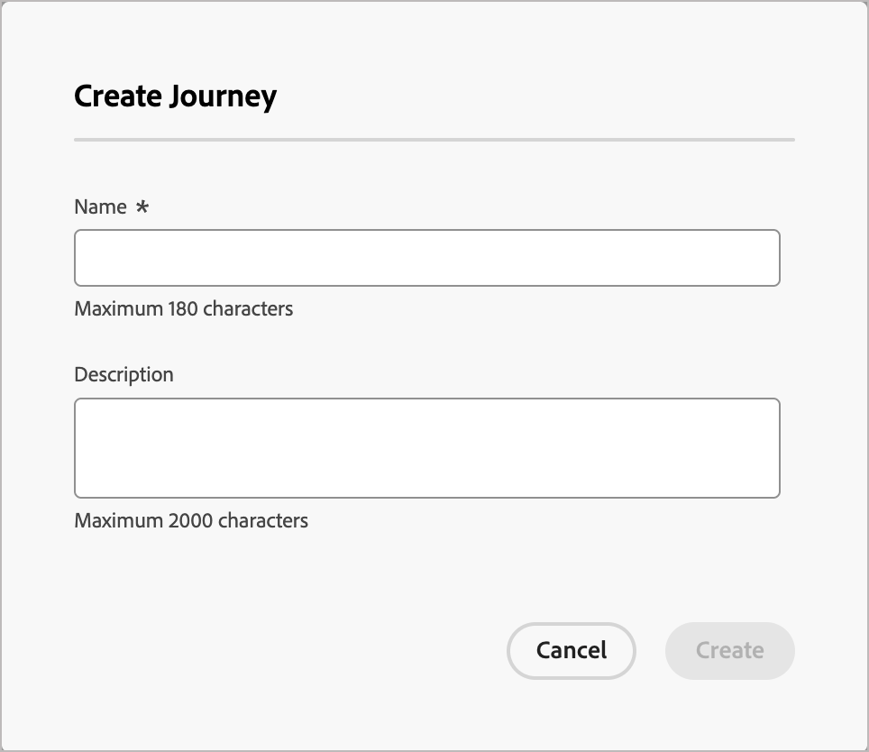
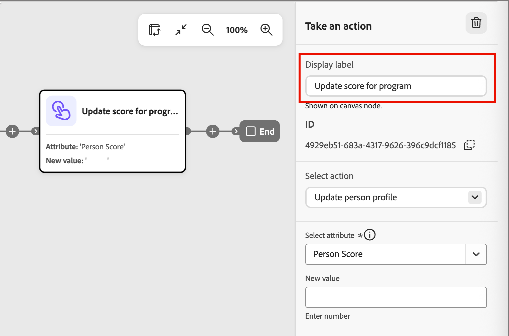

# 여정 작성 및 게시

새 여정을 시작하려면 여정을 만든 다음 여정 맵에서 노드와 여정 흐름을 구성합니다.

{width="30"} [개요 비디오 보기](#overview-video)

## 여정 만들기

왼쪽 탐색 메뉴의 **[!UICONTROL 여정 관리]**&#x200B;에서 만들려는 여정 형식을 선택합니다.

* **[!UICONTROL 계정 여정]**
* **[!UICONTROL 개인 여정]**

새 여정 추가(_T):_

+++계정 여정

1. 페이지 오른쪽 상단에서 **[!UICONTROL 계정 여정 만들기]**&#x200B;를 클릭합니다.

1. 대화 상자에서 고유한 **[!UICONTROL 이름]**(필수)과 **[!UICONTROL 설명]**(선택 사항)을 입력합니다.

   {width="400"}

1. **[!UICONTROL 만들기]**&#x200B;를 클릭합니다.

+++

+++사용자 여정

1. 페이지의 오른쪽 상단에서 **[!UICONTROL 여정 만들기]**&#x200B;를 클릭합니다.

1. 대화 상자에서 고유한 **[!UICONTROL 이름]**(필수)과 **[!UICONTROL 설명]**(선택 사항)을 입력합니다.

   {width="400"}

1. **[!UICONTROL 만들기]**&#x200B;를 클릭합니다.

+++

## 여정 디자인을 위한 구성 요소

_여정 맵_&#x200B;은(는) 여정 작업 영역의 중앙 영역입니다. 이 영역에서 여정 노드를 추가하고 구성할 수 있습니다. 노드를 클릭하여 캔버스 오른쪽에 있는 속성 창을 열고 디자인에 따라 설정합니다. 여정은 항상 여정에 대한 입력을 정의할 수 있는 대상 노드로 시작합니다.

* [계정 대상자 노드](./account-audience-nodes.md)
* [개인 대상 노드](./person-audience-nodes.md)

계정 여정을 만들고 대상을 추가한 후 노드를 사용하여 여정을 디자인합니다. 여정 맵에서는 다음 노드 유형을 사용하여 다단계 B2B 마케팅 사용 사례를 빌드하여 계정 여정을 구성할 수 있는 캔버스를 제공합니다.

* [액션 취하기](./action-nodes.md)
* [이벤트 듣기](./listen-for-event-nodes.md)
* [경로 분할](./split-merge-paths-nodes.md)
* [변형 분할 경로](./variant-split-paths-nodes.md)
* [다음 최적 경로](./next-best-path-node.md)
* [대기](./wait-nodes.md)
* [경로 병합](./split-merge-paths-nodes.md)

## 가드레일

오류가 발생하지 않고 여정을 구축할 수 있도록 다음 보호 기능이 제공됩니다.

* _분할 경로 노드 삭제_: 노드를 삭제하려면 각 경로의 모든 후속 노드를 삭제해야 합니다.
* _병합 노드 삭제_: 연결된 경로가 하나여야 병합 노드를 삭제할 수 있습니다. 병합 노드를 삭제하려면 하나의 경로만 선택한 상태로 둡니다.
* _계정과 사용자 간 전환_: 계정에서 사용자로 선택을 변경하면 각 경로의 모든 후속 노드가 삭제됩니다.

## 노드 추가

1. 여정 맵으로 이동합니다.

1. 경로에서 더하기( **+**) 아이콘을 클릭하고 노드 유형을 선택합니다.

   {width="400" zoomable="no"}

   사용 가능한 노드 유형은 여정 유형과 경로 컨텍스트에 따라 다릅니다. 자세한 내용은 [_여정 노드_](./journey-nodes.md)&#x200B;를 참조하십시오.

1. 오른쪽에서 노드 속성을 설정합니다.

   속성은 노드 유형에 따라 다릅니다.

## 노드 레이블 지정 {#label-a-node}

[!DNL Adobe Journey Optimizer B2B Edition]에서 여정 맵의 각 노드는 _대기_ 또는 _전자 메일 보내기_&#x200B;와 같은 기본 이름을 표시합니다. 같은 유형의 노드를 구분하고 각 단계의 목적을 식별하기 위한 표시 레이블을 추가합니다. 예를 들어 _48시간 쿨다운_ 또는 _환영 이메일_&#x200B;을 사용하세요.

계정 여정 또는 개인 여정의 모든 노드에 표시 레이블을 추가할 수 있습니다.

1. 여정 맵에서 레이블을 지정할 노드를 선택합니다.

1. 노드 속성에서 **[!UICONTROL 표시 레이블]** 필드에 텍스트를 입력합니다.

   레이블에는 최대 255자가 포함될 수 있습니다.

1. 필드 외부를 클릭하여 레이블을 적용합니다.

   {width="500" zoomable="no"}

   이 레이블은 여정 맵의 노드에서 기본 이름을 대체합니다.

기본 이름을 복원하려면 **[!UICONTROL 표시 레이블]** 필드를 지우고 필드 바깥쪽을 클릭합니다.

여정을 게시하면 각 노드의 표시 레이블이 게시된 여정과 함께 저장됩니다.

>[!NOTE]
>
>이 기능을 사용하기 전에 생성된 여정의 노드에는 표시 레이블을 사용할 수 없습니다.

`AJOB2B - 1.5.4 - journey node` 스키마 및 `AJOB2B-1_5_4-journey_node` 데이터 집합에서 노드 레이블을 사용할 수 있습니다. [!DNL Adobe Experience Platform]에서 레이블을 쿼리하여 [!DNL Adobe Customer Journey Analytics]의 보고에 사용할 수 있습니다. 내보낸 데이터 쿼리에 대한 자세한 내용은 [데이터 집합 쿼리 필수 구성 요소](../data/aep-query-examples.md#prerequisites)를 검토하세요.

## 노드 삭제

1. 여정 맵으로 이동합니다.

1. 오른쪽의 노드 속성에서 _삭제_( ) 아이콘을 클릭합니다.

1. 확인 대화 상자에서 **[!UICONTROL 삭제]**&#x200B;를 클릭합니다.

## 경로 추가 및 삭제

1. 여정 맵에서 경로의 더하기( **+**) 아이콘을 클릭하고 [분할 경로 노드](./split-merge-paths-nodes.md#split-paths)를 추가합니다.

1. 오른쪽의 노드 속성에서 **[!UICONTROL 계정]**&#x200B;을(를) 선택합니다.

1. 경로를 더 추가하려면 **[!UICONTROL 경로 추가]**&#x200B;를 클릭하세요.

   여정에서 만든 각 경로에 대해 속성에 새 경로 카드가 나타납니다.

1. 여정의 경로 중 하나로 이동한 다음 더하기 아이콘을 사용하여 해당 경로에 [action](./action-nodes.md) 또는 [event](./listen-for-event-nodes.md) 노드를 추가하십시오.

1. [분할 경로](./split-merge-paths-nodes.md) 노드를 선택하여 오른쪽의 속성을 엽니다.

   노드가 있는 경로는 삭제할 수 없습니다.

1. 경로를 삭제하려면 먼저 해당 경로의 모든 노드를 삭제해야 합니다.

## 여정 예약

여정을 게시할 때 즉시 또는 예약된 향후 날짜에 시작할 수 있습니다. 종료일은 시작일로부터 최대 3년이 될 수 있습니다. 여정이 게시되면(_Live_ 상태) 여정의 종료 날짜는 업데이트할 수 있지만 시작 날짜는 업데이트할 수 없습니다.

1. 여정 맵으로 이동합니다.

1. 헤더에서 **[!UICONTROL 여정 설정]**&#x200B;을 클릭하여 여정을 예약합니다.

1. 대화 상자에서 예약 옵션을 설정합니다.

   * 일정 유형을 선택합니다.

     게시할 때 여정을 활성화하려면 **[!UICONTROL 즉시]**&#x200B;를 선택하십시오.

     미래 날짜에 여정을 활성화하려면 **[!UICONTROL 특정 날짜에]**&#x200B;를 선택하고 _달력_ 아이콘을 클릭하여 날짜를 선택하십시오.

     {width="400" zoomable="no"}

   * 여정의 **[!UICONTROL 종료 날짜]**&#x200B;를 지정하십시오. 시작일로부터 최대 3년이 될 수 있습니다(이 필드는 게시해야 함).

1. **[!UICONTROL 저장]**&#x200B;을 클릭합니다.

   여정을 게시할 준비가 되면 _[!UICONTROL 게시]_&#x200B;를 클릭하면 이러한 설정을 검토할 수 있습니다.

## 여정 게시

차단기 오류가 없는 경우 여정을 게시할 수 있습니다. 게시되면 여정 상태가 _진행 중_&#x200B;으로 변경됩니다. 여정에 오류가 있으면 _[!UICONTROL 게시]_ 단추가 콘텐츠 정보로 흐리게 표시됩니다. `Resolve errors before publishing`.

>[!NOTE]
>
>계정 여정을 게시한 후 자격 있는 계정이 여정에 들어가는 데 최대 24시간이 지연됩니다.

1. 여정 맵의 오른쪽 상단에서 **[!UICONTROL 게시]**&#x200B;를 클릭합니다.

1. _[!UICONTROL 여정 설정 검토]_ 대화 상자에서 여정 시작 옵션을 설정합니다.

   일정을 정의하도록 여정 설정을 이미 설정한 경우 설정을 검토하십시오.

   여정 활성화를 설정해야 하는 경우 일정 유형을 선택합니다.

   * 게시할 때 여정을 활성화하려면 **[!UICONTROL 즉시]**&#x200B;를 선택하십시오.

   * 미래 날짜에 여정을 활성화하려면 **[!UICONTROL 특정 날짜에]**&#x200B;를 선택하고 _달력_ 아이콘을 클릭하여 날짜를 선택하십시오.

1. 필요한 경우 여정의 **[!UICONTROL 종료 날짜]**&#x200B;를 지정하십시오.

   {width="400" zoomable="no"}

   시작일로부터 최대 3년이 될 수 있습니다(이 필드는 게시해야 함).

1. **[!UICONTROL 다음]**&#x200B;을 클릭합니다.

1. 확인 대화 상자에서 **[!UICONTROL 게시]**&#x200B;를 클릭합니다.

## 개요 비디오

>[!VIDEO](https://video.tv.adobe.com/v/3443226/?captions=kor&learn=on)
