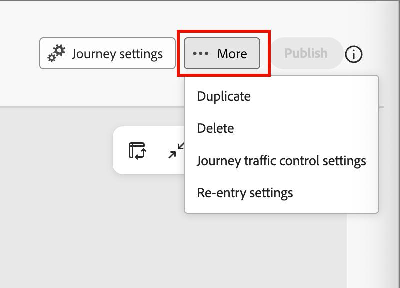

# 여정 트래픽 제어

[!DNL Adobe Journey Optimizer B2B Edition]에서 대상이 자주 겹칩니다. 금융 서비스 회사의 마케팅 이사는 같은 날 업계 여정, 제품 관심사 여정 및 엔터프라이즈 계정 여정을 받을 수 있습니다. 조정하지 않으면 이 세 사람 모두에 등록되고 경쟁 메시지나 중복 메시지를 받게 됩니다. _여정 트래픽 제어_&#x200B;를 사용하여 두 개 이상의 여정을 동시에 받을 수 있는 경우 가장 적합한 한 명의 여정에 각 사용자를 등록하십시오.

여정 트래픽 제어 는 두 개 이상의 참가 여정에 대한 자격이 있는 모든 사람을 검토합니다. 해당 사용자에 대해 알고 있는 내용과 각 여정 목적을 비교하고 가장 일치하는 사용자를 등록합니다. 한 명의 여정에 대해서만 자격이 있는 사람이 해당 여정에 등록되어 있습니다. 자격이 없는 사람은 등록되지 않았습니다.

## 여정 트래픽 제어의 이점 {#benefits}

여정 트래픽 제어는 수동 겹치기 관리를 각 사용자에 대해 기록된 적합성 기반 결정으로 대체합니다.

| 여정 트래픽 제어 없음 | 여정 트래픽 제어 사용 |
|---|---|
| 여러 대상과 일치하는 사람은 여러 여정에 등록되고 중복 메시지를 받습니다. | 각 사람은 각 평가에 대해 최대 하나의 참여 여정에 등록됩니다. |
| 팀은 제외 세그먼트 및 대상 규칙과 겹침을 수동으로 관리합니다. 이 규칙들은 새로운 여정 때마다 유지하기가 더 어려워진다. | 시스템은 적합에 따라 선택합니다. 제외 논리를 빌드하거나 유지 관리하지 않습니다. |
| 어떤 사람이 왜 주어진 여정을 받았는지 설명하기가 어렵다. | 각 경쟁 여정의 점수를 포함하여 모든 결정이 기록되고 볼 수 있습니다. |
| 메시지 피로도 및 혼합 메시징으로 인해 참여가 줄어듭니다. | 각 사용자는 하나의 관련성이 있고 일관된 경험을 얻습니다. |

## 사용 예 {#examples}

여정이 겹치는 대상을 타깃팅할 때 여정 트래픽 제어를 사용합니다. 예:

* **산업 육성 프로그램**: 금융 서비스, 의료 및 제조에 대해 별도의 여정을 실행합니다. 연락처에는 업계 가치가 없지만 프로필이 은행 계좌에 연결되어 있습니다. 여정 트래픽 제어는 세 가지 모두를 등록하지 않고 금융 서비스 여정 연락처와 일치시킵니다.
* **제품 관심 캠페인**: 각 제품 라인에 대해 하나의 여정을 실행합니다. 최근 두 상품에 대한 관심도가 높은 잠재 고객이 관심도가 가장 높은 상품 여정에 등록된다.
* **역할 기반 메시징**: 기술 평가자와 경영진 스폰서에게 각각 여정을 실행합니다. 개인의 직책 및 기능이 어떤 여정에 가입할지 결정합니다.
* **엔터프라이즈 및 SMB 프로그램**: 회사 규모별로 다른 여정을 실행합니다. 연락처의 고객 세그먼트 및 계정 정보가 가입하는 여정을 결정합니다.
* **새 여정 실행**: 다른 여정이 이미 다루는 대상에 새 여정을 게시합니다. 여정 트래픽 컨트롤은 겹침을 평가하므로 기존 대상 규칙을 다시 디자인하지 않습니다.

## 맞춤 선택 {#dimensions}

한 사람이 두 개 이상의 여정에 참가할 수 있는 경우 여정 트래픽 제어에서는 해당 사용자의 프로필을 각 후보 여정의 이름 및 설명과 비교합니다. 비교에는 네 가지 차원이 포함됩니다.

| 차원 | 비교 항목 |
|---|---|
| 업종 | 개인 산업입니다. 산업이 누락된 경우 연결된 계정의 산업입니다. |
| 기능적 맞춤 | 개인의 역할 및 직무 기능. |
| 회사 규모 | 개인의 고객 세그먼트, 계정 유형 및 지출 컨텍스트. |
| 의도 | 최근 가장 강한 관심을 보인 제품입니다. |

다음 사항을 염두에 두십시오.

* **여정 이름과 설명은 중요합니다.** 각 여정의 용도를 시스템에 알려줍니다. 구체적이고 정확한 설명이 더 잘 일치합니다.
* **누락된 데이터를 건너뛰었습니다. 확인하지 않았습니다.** 개인에게 차원에 대한 값이 없는 경우 여정 트래픽 제어 는 해당 개인에 대해 해당 차원을 제외합니다. 데이터가 있는 차원을 결정합니다.

보고 보기의 각 사용자에 대한 결정 레코드는 모든 경쟁 여정 및 사용된 차원에 대한 점수를 보여줍니다. 데이터가 없는 차원은 제외됨으로 표시됩니다.

### 비교 {#comparisons}

각 여정에 대해 여정 트래픽 컨트롤은 직책과 같은 해당 사용자의 관련 텍스트를 각 차원의 설명과 비교합니다. 두 가지 방법을 사용합니다.

* **유사성의 의미**: 텍스트에 설명과 유사한 의미가 있습니까?
* **키워드 일치**: 텍스트에 설명과 동일한 용어가 사용됩니까?

두 방법의 결과가 더 강하면 해당 차원에 대한 여정 점수가 됩니다.

그런 다음 각 차원은 최상의 점수 여정을 제안하지만, 점수가 최소 품질 임계값을 지우는 경우에만 제안됩니다. 적격 제안이 없는 여정은 삭제됩니다. 구성하는 가중치는 결합된 가중 점수에 따라 나머지 여정의 등급을 지정합니다. 점수가 가장 높은 여정이 선택됩니다. 승자가 반드시 가장 많은 제안을 한 여정이 되는 것은 아니다. 한 차원에 대한 강한 한판 승부가 몇 차례 약한 승부보다 더 중요하다.

각 결정 레코드는 다음 정보를 저장합니다.

* 선택한 여정 및 경쟁 여정
* 각 차원에 대한 점수와 결합 점수
* 신뢰도 값
* 승자를 지원하는 차원의 수를 보여 주는 높음, Medium 또는 낮음의 계약 수준

<!-- CONFIRM with Engineering: whether to describe the fallback when no dimension produces a qualifying match. The source says the person is still enrolled in one eligible journey, selected consistently, with a 0% (Low) confidence decision record. Also confirm how "consistent" should be phrased. -->

## 구성 {#configuration}

여정 트래픽 제어 차원 가중치를 설정하고 점수를 시뮬레이션하려면 다음을 수행합니다.

1. 왼쪽 탐색에서 **[!UICONTROL 여정 관리]** > **[!UICONTROL 여정 트래픽 제어]**(으)로 이동합니다.

1. **[!UICONTROL 구성]** 탭을 선택합니다.

각각 25%의 Medium으로 설정된 4개의 여정 가중치 카드가 있는 {width="800" zoomable="yes"}

### 차원 가중치 조정 {#weights}

기본적으로 4개의 차원은 모두 _Medium_&#x200B;의 가중치를 가지며 각 25%씩 동일하게 기여합니다. 가중치를 조정하여 각 차원이 의사 결정에 영향을 미치는 정도를 변경합니다.

1. 각 차원에 대해 가중치 수준을 설정합니다.

   * **[!UICONTROL 해제]**
   * **[!UICONTROL 낮음]**
   * **[!UICONTROL Medium]**
   * **[!UICONTROL 높음]**

   각 카드의 백분율은 설정이 결합된 후 해당 차원의 몫을 보여 줍니다. 의사 결정에서 차원을 제거하려면 **[!UICONTROL 해제]**(으)로 설정하십시오.

   {width="600"})로 설정됨

   각 카드에 표시된 백분율은 모든 선택 항목을 조합한 후 해당 차원의 정규화된 기여도로, 항상 합계가 100%입니다. 한 개의 차원을 높이면 다른 차원이 자동으로 다시 표준화되어 합계가 100%로 유지됩니다.

   모든 차원을 짝수 가중치로 되돌리려면 **[!UICONTROL 같음으로 재설정]**&#x200B;을 클릭합니다.

1. 조정된 가중치를 적용하려면 **[!UICONTROL 가중치 저장]**&#x200B;을 선택합니다.

   >[!NOTE]
   >
   >차원 가중치에 변경 사항을 저장하려면 _[!UICONTROL B2B 관리 구성 관리]_ [제품 권한](../admin/user-management.md#b2b-product-permissions)이 있어야 합니다.

### 점수 시뮬레이션 {#simulate-scoring}

프로덕션에 가중치를 커밋하기 전에 트래픽 제어가 이러한 변경 사항과 함께 작동하는 방식을 시뮬레이션할 수 있습니다. 시뮬레이션은 여정 트래픽 제어를 활성화할 필요가 없습니다. 라이브 여정에 이미 있는 프로필을 평가하고 트래픽 제어 논리를 적용합니다. 그러면 당신은 결과가 가중치 설정에 맞게 보이는지 판단할 수 있다.

**[!UICONTROL 점수 시뮬레이션]**&#x200B;을 클릭합니다.

결과 헤더에 다음 실행이 요약됩니다.

* **평가된 프로필** — 채점된 프로필 수와 전체 여정 수입니다.
* **평균 충돌/프로필** — 프로필당 경쟁 여정의 평균 수입니다.
* **평균 일치 점수** — 선택한 여정의 평균 신뢰도입니다.

{width="700" zoomable="yes"}

평가된 각 프로필은 선택한 여정, 주요 근거, 의도 신호 및 일치 점수를 보여주는 카드로 표시됩니다. 세부 사항 보기를 열 프로필 선택:

* **일치 점수** — 차원별로 색상으로 구분된 분류와 함께 전체적으로 일치합니다.
* **여정 점수** — 이 사람이 자격을 얻은 여정, 선택된 점수 및 그 이유입니다.
* **고려된 차원** - 의사 결정을 유도한 차원 데이터로, 기본 신호를 표시하도록 확장 가능합니다.

{width="450" zoomable="yes"}

필요한 경우 차원 가중치를 조정하고 **[!UICONTROL 다시 실행]**&#x200B;을 클릭하여 시뮬레이션을 다시 실행하십시오.

**[!UICONTROL 새 사용자 샘플링]**&#x200B;을 클릭하여 새로운 무작위 샘플을 사용하여 시뮬레이션을 다시 실행할 수도 있습니다.

결과에 만족하면 **[!UICONTROL 가중치 저장]**&#x200B;을 클릭하여 가중치를 커밋할 수 있습니다. 새 트래픽 제어 결정은 새 설정을 즉시 사용하지만 이전 결정은 영향을 받지 않습니다. 테스트한 가중치는 기본 _[!UICONTROL 구성]_ 탭에 표시되며 라이브 환경에서 평가하는 모든 여정 트래픽 제어에 사용됩니다.

가중치를 적용하지 않고 페이지를 나갈 수도 있습니다.

## 보고 검토 {#reporting}

보고 보기를 사용하여 여정 트래픽 제어가 사람을 등록하는 방법을 확인합니다. 여정 또는 실행별로 결정을 검토합니다.

### 여정 보고 {#reporting-by-journey}

**[!UICONTROL 여정]** 보기에는 트래픽 제어의 여정이 요약됩니다.

| 지표 | 설명 |
|---|---|
| 관리 여정 | 트래픽 제어에 참여하는 여정. |
| 경합 여정 | 최소 한 명 이상의 다른 여정과 사람들을 공유하는 여정. |
| 프로필 경합 | 두 명 이상의 여정이 주장하는 고유 사용자. |
| 등록한 사람 | 등록된 고유 사용자입니다. |

각 여정에 대해 보기에는 다음 값도 표시됩니다.

* **[!UICONTROL 등록됨]**: 등록한 총 사람 수
* **[!UICONTROL 무경쟁]**: 이 여정에 대해서만 자격이 있는 사용자.
* **[!UICONTROL 원화]**: 여러 여정에 대한 자격이 있고 이 이벤트에 등록된 직원입니다.
* **[!UICONTROL 승률]**: 사람들이 여정에 대해 경쟁했을 때 승리한 빈도입니다.

{width="700" zoomable="yes"}

[여정 상태](./journeys-overview.md#journey-status): [!UICONTROL Live], [!UICONTROL 완료됨], [!UICONTROL 중단됨] 또는 [!UICONTROL 모두]별로 목록을 필터링합니다.

여정의 경합 대상자가 어디까지 도달했는지 확인하려면 여정을 엽니다. 세부 사항 보기에는 사용자가 대신 등록한 여정이 표시됩니다. 일치 점수, 경쟁 여정, 각 항목에 대한 점수 및 사용된 차원을 보려면 등록된 사람의 결정 레코드를 확장합니다. 이름, 잠재 고객 ID 또는 프로필 ID로 검색합니다.

등록 지표, 여정이 도착한 위치 차트 및 등록된 사람 표가 포함된 {width="700" zoomable="yes"}

업계 또는 의도 제품이 여정 간에 배포되는 방식을 비교하려면 **[!UICONTROL 여정 비교]**&#x200B;를 선택하고 최소 두 개 이상 및 최대 20개의 라이브 여정을 선택합니다.

<!-- Figure placeholders: By Journey overview, journey detail "Where contested profiles landed", and a decision record. Redact person names and use clean sample journey names without test prefixes. Choose runs with healthy enrollment counts. -->

### 실행별 보고 {#reporting-by-run}

다음 정보가 포함된 각 평가 실행 목록을 보려면 **[!UICONTROL 실행별]**&#x200B;을(를) 선택하십시오.

* 실행 시간
* 실행이 트리거된 방법: *예약됨*, *게시 중* 또는 *수동*
* 평가, 등록 및 등록되지 않은 사람 수

{width="700" zoomable="yes"}

시간 범위(24시간, 7일, 30일 또는 항상) 및 트리거 유형별로 목록을 필터링합니다.

평가된 사람에서 등록된 여정에 대한 플로우 다이어그램을 보려면 실행을 엽니다. 각 여정의 분류에는 **[!UICONTROL 등록되지 않음]**, **[!UICONTROL 등록됨]**, **[!UICONTROL 중재]**(경쟁 여정 중 선택됨) 및 **[!UICONTROL 무경쟁]**&#x200B;의 사용자 수가 표시됩니다. 실행된 모든 여정에 대해 평가된 사람, 결과, 경합한 여정 및 일치 점수를 볼 수도 있습니다.

{width="500" zoomable="yes"}

<!-- CONFIRM with Product: what the scheduled and on-publish triggers mean for customers, and the content of the Not enrolled tooltip. -->

## 평가 실행 프로세스 {#run-process}

각 실행은 동일한 시퀀스를 따릅니다. 여정 트래픽 컨트롤은 [!DNL Journey Optimizer B2B Edition] 환경에 이미 있는 데이터만 읽으며 추가 데이터 원본이 필요하지 않습니다.

1. 여정 트래픽 컨트롤은 사용자 환경의 사용자 및 계정 [프로필 새로 고침](../data/data-availability-timing.md#daily-refresh)이 완료될 때까지 기다립니다. 새로 고침이 실패하면 오래된 데이터에 대한 실행이 시작되지 않습니다.

1. 대상 멤버십은 [!DNL Adobe Experience Platform] 및 [동기화됨](../data/data-availability-timing.md#platform-sync)에서 [!DNL Journey Optimizer B2B Edition]에 계산됩니다. 세그먼테이션이 완료된 후 시스템은 최대 30분 동안 동기화가 완료될 때까지 기다립니다. 동기화가 더 빨리 완료되면 즉시 처리가 시작됩니다. 30분을 먼저 넘기면 어쨌든 처리가 시작됩니다. 나중에 동기화가 완료되면 업데이트된 데이터에서 새 실행이 시작됩니다.

1. 시스템이 후보 여정을 조합합니다. 라이브 상태이며 트래픽 제어에 사용할 수 있는 여정만 참여합니다. 시스템은 각 여정의 상태, 이름 및 설명을 읽습니다.

1. 시스템은 대상자 멤버십과 프로필 컨텍스트를 작은 배치로 읽습니다.

1. 시스템이 적격성을 확인합니다. 다음 사항이 모두 참인 경우에만 여정을 받을 수 있습니다.

   * 여정이 라이브이며 트래픽 제어에 대해 활성화됩니다.
   * 해당 인물은 현재 여정 대상의 구성원입니다.
   * 해당 여정에 등록된 적이 없습니다.
   * 해당 여정에 현재 등록되어 있지 않습니다.

1. 시스템이 여정을 선택합니다. 한 명의 적격 여정이 있는 사람이 등록됩니다. 적격한 여정이 없는 사람은 등록되지 않습니다. 자격 있는 여정이 여러 개인 사용자의 경우, 시스템은 해당 사용자의 프로필을 [4개 차원](#dimensions)의 각 여정 이름 및 설명과 비교합니다.

1. 시스템은 표준 여정 등록 메커니즘을 통해 선택한 여정에 등록을 제출합니다.

1. 시스템은 보고 및 감사를 위해 각 결정 및 등록 결과를 저장합니다.

1. 배치가 완료되고 결과를 기록하고 완료 알림을 전송할 때 시스템 체크포인트가 진행됩니다.

## 사용 및 저장된 데이터 {#data}

여정 트래픽 컨트롤은 환경의 다음 데이터를 사용합니다.

| 데이터 | 소스 | 사용 |
|---|---|---|
| 여정 상태, 이름 및 설명 | 내 여정 | 참여하는 여정과 각 여정의 용도를 결정합니다. |
| 대상자 멤버십 | [!DNL Experience Platform]명의 대상이 [!DNL Journey Optimizer B2B Edition]에 동기화되었습니다. | 각 여정에 적합한 사용자를 식별합니다. |
| 업계, 직책 및 기능, 고객 세그먼트 등 개인 프로필 | 사용자 데이터 | 업계, 기능 적합성 및 회사 규모 차원을 제공합니다. |
| 산업 및 계정 유형과 같은 연결된 계정 프로필 | 계정 데이터 | 개인 자신의 값이 누락된 경우 산업을 입력하고 계정 컨텍스트를 제공합니다. |
| 제품 관심 | [의도 데이터](../admin/intent-data.md) | 의도 차원을 제공합니다. 가장 최근의 관심이 가장 강한 제품이 사용됩니다. |
| 등록 내역 | 이전 실행에서 작성된 레코드 | 동일한 사람을 동일한 여정에 반복적으로 등록하지 마십시오. |
| 현재 등록 상태 | [!DNL Journey Optimizer B2B Edition] | 이미 여정에 있는 사람은 등록하지 마십시오. |

매 실행 시 여정 트래픽 제어는 실행 요약을 저장합니다. 등록된 모든 개인에 대해 등록 결정 레코드를 저장합니다. 둘 다 환경의 Adobe 관리 데이터 저장소에 저장됩니다. 보고서를 실행하고 반복 등록을 방지합니다.

<!-- 
CONFIRM with Engineering, Security, and Legal before publishing. The source material does not state any of the following data handling commitments:
- Where processing occurs and data residency.
- Whether meaning similarity comparison uses a third-party or externally hosted AI service, and whether profile text leaves the Adobe environment.
- Whether customer data is used to train models shared with other customers.
- The retention period for decision and enrollment records, and how they are deleted when a person is erased (link to privacy requests).
- Encryption in transit and at rest, role-based access to the reports, and tenant isolation. 
-->

## 여정 트래픽 제어 설정 {#setup}

_초안_ 상태일 때 개별 [개인 여정](./create-publish-journey.md)에서 직접 여정 트래픽 제어를 활성화할 수 있습니다.

1. 개인 여정에게 여정의 명확한 목적과 목표를 제공하는 이름과 설명이 있는지 확인합니다.

   이러한 이름과 설명이 일치의 기준이 됩니다.

1. **[!UICONTROL 클릭... 여정 캔버스의 오른쪽 상단에서]**&#x200B;을(를) 더 보고 **[!UICONTROL 여정 트래픽 제어 설정]**&#x200B;을(를) 선택하십시오.

   {width="400"}

1. 대화 상자에서 **[!UICONTROL 여정 트래픽 제어 사용]** 옵션을 활성화합니다.

   설정 대화 상자는 동작을 설명합니다. 활성화하면 여정이 후보가 되고, 모델은 여러 활성 여정에 대한 자격이 있는 사람에게 가장 적합한 여정을 평가하고 권장합니다.

   {width="450"}

   >[!IMPORTANT]
   >
   >여정이 _초안_ 상태에 있는 동안 언제든지 토글을 변경할 수 있습니다. 여정 트래픽 제어가 활성화된 여정을 게시하면 해당 여정에 대한 항목을 평가하므로 더 이상 설정을 비활성화할 수 없습니다.

1. **[!UICONTROL 저장]**&#x200B;을 클릭합니다.

1. 개인 여정 [게시](./create-publish-journey.md#publish-a-journey).

## 제한 사항 및 종속성 {#limitations}

다음 종속성은 여정 트래픽 제어가 작동하는 시기와 방식에 영향을 줍니다.

* **대상 동기화**: 결정은 [!DNL Experience Platform]에서 [!DNL Journey Optimizer B2B Edition]&#x200B;(으)로 동기화된 최신 대상 멤버십에 의존합니다. 실행 타이밍은 세그먼테이션 및 동기화 완료를 따릅니다. 정해진 일정은 아닙니다.
* **프로필 새로 고침**: 사용자 및 계정 프로필 새로 고침이 성공한 후에만 실행이 시작됩니다.
* **여정 메타데이터**: 트래픽 제어에 사용할 수 있는 라이브 여정만 참여합니다. 일치하는 항목의 품질은 사용자가 작성하는 이름과 설명에 따라 다릅니다.
* **프로필 완성도**: 품질은 유지 관리하는 사용자, 계정 및 의도 데이터에 따라 다릅니다. 누락된 차원은 건너뜁니다.

여정 트래픽 제어에는 다음과 같은 제한 사항이 있습니다.

* **한 사람당 하나의 여정**: 한 사람이 각 실행에 대해 최대 하나의 여정에 등록됩니다.
* **선택은 등록을 보장하지 않습니다**: [!DNL Experience Platform]의 동기화가 완료될 때까지 일부 프로필이 일치하는 Marketo 개인 ID 없이 평가될 수 있습니다. 여정이 선택되었지만 등록하지 못할 수 있습니다. 이 사람들은 실행 보고에 *등록되지 않음*(으)로 표시됩니다.
* **반복 등록 없음**: 여정 트래픽 제어에서 이전에 등록한 여정에 개인을 등록하지 않습니다. 사용자가 여정을 다시 인증하도록 하려면 [여정 다시 입력 설정](./journey-re-entry.md)을 사용하세요.
* **실시간 아님**: 프로필이 변경될 때가 아니라 실행이 발생할 때 결정됩니다.
* **고정 차원 4개**: 업계, 기능 적합성, 회사 규모 및 의도의 중요도를 조정할 수 있지만 차원을 추가할 수는 없습니다.
* **텍스트 기반 일치**: 여정 이름 및 설명을 프로필 텍스트와 비교합니다. 모호하거나, 비어 있거나, 유사한 설명이 있는 여정은 구분하기가 더 어렵습니다. 약하게 차별화된 여정은 낮은 신뢰 결과를 낳을 수 있다.

여정 트래픽 제어는 개인이 등록된 적격 여정만 결정합니다. 여정 또는 대상은 변경되지 않습니다.

<!-- CONFIRM with Product and Engineering: the maximum number of governed journeys, maximum audience size for each run, supported editions and regions, and any language limitations for text matching. -->
